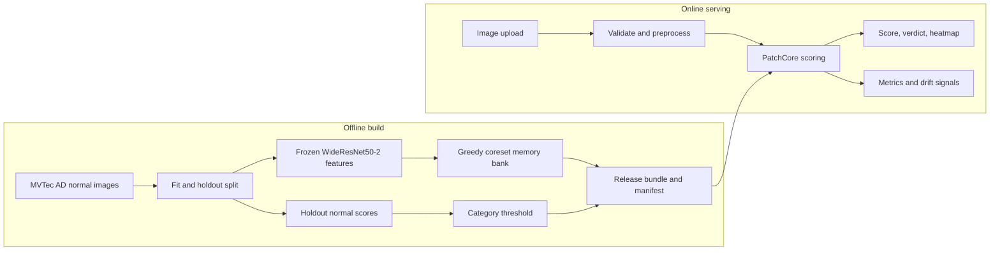

# Visual Anomaly Detection (PatchCore from scratch)

[](https://github.com/Exiver/anomaly-detection/actions/workflows/ci.yml)

This project implements PatchCore from scratch in PyTorch for unsupervised industrial anomaly detection, compares it with an autoencoder baseline and an anomalib reference, and serves category-specific models through FastAPI. The generated result tables below are built from the checked-in evaluation CSVs; their confidence intervals are the 99.5% intervals saved by the current evaluator. They are not 95% intervals.

**Demo:** [Hugging Face Space](https://huggingface.co/spaces/FathyElghoneimy/space_bundle) — open `/demo` for the interactive page. The current v2 release manifest lists the categories served by the demo.

## Architecture



## Results

<!-- BEGIN AUTO RESULTS -->
_Generated from the evaluation CSVs by `python scripts/make_docs.py`. See [the full results report](reports/RESULTS.md) for the interval method, framework comparison, calibration, per-defect evidence, and environment._

### Autoencoder baseline

| category | image AUROC (99.5% CI) | pixel AUROC | PRO | test images | defective |
|---|---|---|---|---|---|
| bottle | 0.913 (0.831-0.979) | 0.745 | 0.549 | 83 | 63 |
| cable | 0.535 (0.413-0.658) | 0.648 | 0.405 | 150 | 92 |
| capsule | 0.672 (0.520-0.805) | 0.922 | 0.729 | 132 | 109 |
| carpet | 0.673 (0.500-0.814) | 0.750 | 0.522 | 117 | 89 |
| grid | 0.977 (0.916-1.000) | 0.934 | 0.887 | 78 | 57 |
| hazelnut | 0.972 (0.930-0.997) | 0.978 | 0.854 | 110 | 70 |
| leather | 0.769 (0.642-0.870) | 0.965 | 0.898 | 124 | 92 |
| metal_nut | 0.502 (0.330-0.682) | 0.649 | 0.357 | 115 | 93 |
| pill | 0.667 (0.533-0.801) | 0.902 | 0.835 | 167 | 141 |
| screw | 0.697 (0.565-0.826) | 0.956 | 0.827 | 160 | 119 |
| tile | 0.724 (0.589-0.845) | 0.565 | 0.459 | 117 | 84 |
| toothbrush | 0.975 (0.877-1.000) | 0.927 | 0.799 | 42 | 30 |
| transistor | 0.598 (0.444-0.773) | 0.728 | 0.531 | 100 | 40 |
| wood | 0.944 (0.871-0.997) | 0.786 | 0.667 | 79 | 60 |
| zipper | 0.871 (0.749-0.957) | 0.829 | 0.559 | 151 | 119 |
| **macro mean** | 0.766 (n/a) | 0.819 | 0.658 | 1725 | 1258 |

### PatchCore (from scratch)

| category | image AUROC (99.5% CI) | pixel AUROC | PRO | test images | defective |
|---|---|---|---|---|---|
| bottle | 1.000 (1.000-1.000) | 0.980 | 0.930 | 83 | 63 |
| cable | 0.991 (0.974-0.999) | 0.984 | 0.937 | 150 | 92 |
| capsule | 0.963 (0.875-0.998) | 0.985 | 0.903 | 132 | 109 |
| carpet | 0.968 (0.914-0.996) | 0.987 | 0.916 | 117 | 89 |
| grid | 0.980 (0.920-1.000) | 0.985 | 0.922 | 78 | 57 |
| hazelnut | 1.000 (0.996-1.000) | 0.986 | 0.865 | 110 | 70 |
| leather | 0.997 (0.986-1.000) | 0.992 | 0.958 | 124 | 92 |
| metal_nut | 0.998 (0.989-1.000) | 0.984 | 0.916 | 115 | 93 |
| pill | 0.932 (0.867-0.983) | 0.957 | 0.920 | 167 | 141 |
| screw | 0.969 (0.907-1.000) | 0.994 | 0.968 | 160 | 119 |
| tile | 0.991 (0.966-1.000) | 0.937 | 0.772 | 117 | 84 |
| toothbrush | 1.000 (1.000-1.000) | 0.986 | 0.878 | 42 | 30 |
| transistor | 0.998 (0.988-1.000) | 0.951 | 0.913 | 100 | 40 |
| wood | 0.990 (0.962-1.000) | 0.943 | 0.860 | 79 | 60 |
| zipper | 0.992 (0.971-1.000) | 0.987 | 0.947 | 151 | 119 |
| **macro mean** | 0.985 (n/a) | 0.976 | 0.907 | 1725 | 1258 |

The saved category-level intervals overlap in 4 of 15 categories. This is a descriptive overlap check, not a paired statistical test.
<!-- END AUTO RESULTS -->

The full report includes the interval method, comparison with anomalib, available threshold calibration, performance variants, weakest per-defect AUROCs, and the environment snapshot: [reports/RESULTS.md](reports/RESULTS.md). The comparison is descriptive; overlapping intervals are not evidence of a clear difference, and they are not a paired statistical test. The saved Phase 4 notes describe an earlier evaluation transform without ImageNet normalization, while the current pipeline normalizes; the CSVs do not record which transform revision produced them. Rerun evaluation before presenting the values as measurements of the current code.

### Against a reference implementation

See the generated framework comparison tables in [reports/RESULTS.md](reports/RESULTS.md). The saved files include a PatchCore comparison and a `k1` variant. Differences in feature map size and score ranking mean the two implementations are not numerically interchangeable.

### Operating threshold

The checked-in calibration covers bottle only. Its table includes an oracle row that uses test labels; that row is an upper bound and is not a deployable threshold. Threshold behavior on other categories must be calibrated and validated separately.

### Speed and memory

The checked-in precision experiment covers bottle and carpet on the recorded GPU. Its reported latency and memory values are specific to that hardware and workload. An ONNX/int8 results file is not present; that experiment was not run.

## Failure modes

The PatchCore per-defect table identifies weaker separation for pill cracks, grid glue, and capsule scratches in the full benchmark evaluation. See [reports/RESULTS.md](reports/RESULTS.md); the corresponding local galleries are `reports/errors_patchcore_pill.png`, `reports/errors_patchcore_grid.png`, and `reports/errors_patchcore_capsule.png`. Those categories are outside the current v2 serving release. For the served categories, the manifest shows a higher test false-positive rate for carpet than for bottle or hazelnut; its local error gallery is `reports/errors_patchcore_carpet.png`. Report galleries are not committed because they contain MVTec examples.

## How to run

```powershell
conda create -n ai-engineering python=3.11
conda activate ai-engineering
# Install the CPU or CUDA PyTorch build appropriate for your machine first.
python -m pip install -e ".[train,service,dev]"

# Download MVTec AD from its official page into data/mvtec_ad/.

# Tests and lint
python -m pytest -p no:cacheprovider -q
ruff check .

# Train/evaluate, then build a release and serve it
python scripts/run_ae.py
python scripts/run_patchcore.py
python scripts/build_release.py --version v2 --categories bottle carpet hazelnut
uvicorn anomaly.service.main:app --host 0.0.0.0 --port 8000
# Demo at /demo; API docs at /docs

# Container
docker compose up --build
```

The exact reproduction workflow and the commands used for each report are in [docs/REPRODUCE.md](docs/REPRODUCE.md).

## Repository layout

```text
src/anomaly/       models, data pipeline, serving, metrics, and reporting code
scripts/           training, evaluation, export, deployment, and documentation commands
tests/             unit and service tests
docs/              reproduction steps and reserved demo evidence images
reports/           generated tables, evaluation CSVs, and error galleries
releases/          local versioned model releases (model files are not committed here)
```

## Limitations

- MVTec AD is a benchmark with clean, aligned images; real production lighting, camera, motion, and domain shifts may change performance.
- Test sets and defect groups are limited; interval overlap does not establish a difference, and intervals do not represent variation across factories or cameras.
- The report macro-averages categories equally; it is not an image-weighted or pooled pixel metric.
- Threshold calibration is available only for bottle in the checked-in report. Each category needs representative normal data and its own validation.
- There is one model per category, not one model for every product type.
- Drift signals compare recent unlabeled traffic with a small reference. They can indicate distribution change but cannot establish live accuracy; production labels are unavailable.
- The precision study covers only two categories and one GPU; its speed and memory results are not hardware guarantees.
- The evaluation CSVs do not record the preprocessing revision. Earlier Phase 4 notes describe unnormalized inputs, while current code applies ImageNet normalization; rerun evaluation before treating old scores as current.

## Data and license

The project code is licensed under [MIT](LICENSE). MVTec AD is a separate dataset licensed under [CC BY-NC-SA 4.0](https://www.mvtec.com/research-teaching/datasets/mvtec-ad); MVTec states that commercial use of the dataset is not allowed. The code license does not grant rights to the dataset or model artifacts trained from it. Treat those artifacts as non-commercial unless MVTec confirms otherwise.

## References

- Roth et al., “Towards Total Recall in Industrial Anomaly Detection,” CVPR 2022 (PatchCore).
- Bergmann et al., “MVTec AD: A Comprehensive Real-World Dataset for Unsupervised Anomaly Detection,” CVPR 2019.
- The anomalib version detected from export metadata is listed in [reports/environment.txt](reports/environment.txt); it is marked unknown if the metadata is unavailable.
